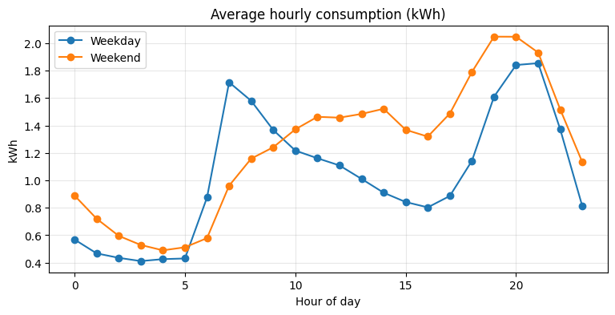
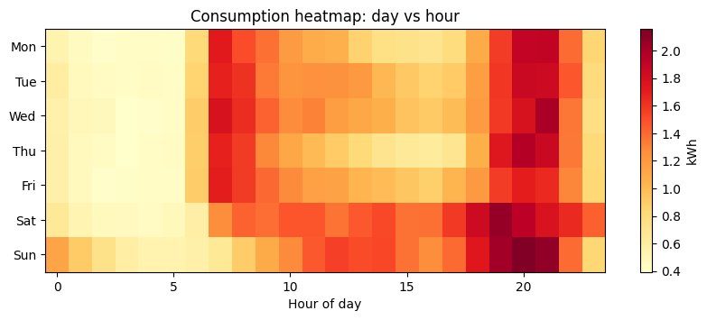
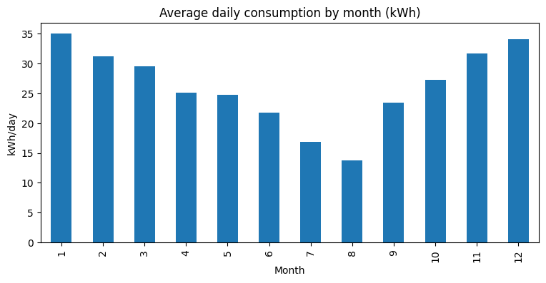
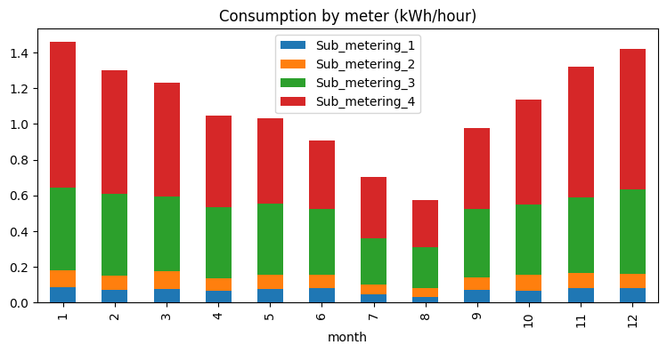

# Household Electricity Consumption Analysis

**When does a household use the most electricity, and what drives its peaks?**

An exploratory analysis of four years of minute-level electricity readings from a single household, covering data cleaning, daily/weekly/seasonal patterns, and what is actually behind the evening peak.

## Dataset

- **Source:** Individual Household Electric Power Consumption (UCI Machine Learning Repository / Kaggle)
- **Size:** 2,075,259 readings, one per minute, December 2006 to November 2010
- **Measurements:** active and reactive power, voltage, current intensity, and three sub-meters:
  - Sub-meter 1: kitchen (dishwasher, oven, microwave)
  - Sub-meter 2: laundry room
  - Sub-meter 3: electric water heater and air conditioner
- **Derived column:** `Sub_metering_4`, the energy not covered by the three sub-meters (lighting, electronics, other appliances, and possibly heating):
  `active power x 1000 / 60 - sub1 - sub2 - sub3` (Wh per minute)

## Data cleaning

| Check | Finding | Decision |
|---|---|---|
| Missing values | 25,979 rows (1.25%), always entire rows (all 7 columns), i.e. recording outages | Treated as outages, not sensor faults |
| Gaps | 71 gaps; 7 long gaps (891 to 7,226 min) make up about 98% of all missing data | Gaps of 60 min or less filled by time interpolation (288 minutes); long gaps left missing rather than guessed |
| Duplicates / missing timestamps | None | None needed |
| Outliers | Voltage 223 to 254 V, peak power 11.1 kW: all plausible | Kept |
| Negative `Sub_metering_4` | 1,050 values (0.05%), minimum -2.4 Wh, consistent with measurement rounding | Clipped to 0 |

Data was then aggregated to hourly averages (kWh). December 2006 and November 2010 were excluded from monthly comparisons because they are incomplete months.

## Key findings

### 1. Weekdays have two peaks, weekends one

- Weekdays: a sharp morning peak at 07:00 (about 1.7 kWh) and a larger evening peak at 20:00 to 21:00 (about 1.85 kWh).
- Weekends: no sharp morning peak, higher midday use, and the highest evening peak (about 2.05 kWh at 19:00 to 20:00).
- The nightly minimum (03:00 to 05:00, about 0.4 kWh) is roughly 4.5 times lower than the evening peak.

Sunday evening is the highest-consumption period of the week.

### 2. Strong seasonality

Average daily consumption is **35.1 kWh in January versus 13.8 kWh in August**, about 2.5 times higher in winter.

### 3. Half of the consumption is not covered by the sub-meters

| Meter | Share of total |
|---|---|
| Sub-meter 3 (water heater / AC) | 35.8% |
| Sub-meter 2 (laundry) | 7.2% |
| Sub-meter 1 (kitchen) | 6.2% |
| **Unmetered** | **50.8%** |

The unmetered part grows from roughly 0.26 kWh/hour in August to 0.82 kWh/hour in January. A likely explanation is heating, but this is a hypothesis: the data does not measure it directly.

### 4. What drives the evening peak?

Hours 18:00 to 21:59 are 17% of the day but account for **about 26% of consumption**. Comparing average hourly use inside and outside this window:

| Source | Off-peak (kWh/h) | Peak (kWh/h) | Share of the increase |
|---|---|---|---|
| Unmetered | 0.457 | 1.009 | ~75% |
| Kitchen (sub 1) | 0.052 | 0.143 | ~12% |
| Water heater / AC (sub 3) | 0.378 | 0.428 | ~7% |
| Laundry (sub 2) | 0.070 | 0.114 | ~6% |

The water heater, often assumed to cause evening peaks, barely changes. The peak is driven mainly by the **unmetered load**.

## Recommendations

1. **Measure before optimizing.** Since about three quarters of the evening increase comes from unmetered circuits, add sub-metering (for example on lighting and living-area circuits) to identify what actually drives it.
2. **Shifting loads has limited potential.** Kitchen and laundry together explain only about 18% of the evening increase. Running the dishwasher and washing machine outside 18:00 to 22:00 is still a free, low-effort step.
3. **Target the winter baseline.** Winter consumption is 2.5 times summer, and the unmetered part doubles. If it is heating, thermostat scheduling and insulation checks are the larger opportunity.

## Limitations

- One household in France: findings describe this home, not households in general.
- About 1.2% of data is missing, mostly in a few long outages that were deliberately not imputed.
- `Sub_metering_4` is derived, and its composition (lighting, electronics, heating) is inferred from context, not measured.
- This is an exploratory analysis; no causal claims or forecasting models are included.

## Tools

Python, Pandas, Matplotlib, Google Colab.

## Files

- `analysis.ipynb`: full notebook (cleaning, aggregation, charts, peak analysis)
- `*.png`: charts used in this report
